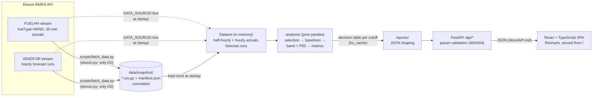

# Wind Forecast Desk

A day-ahead decision tool for a UK utility's power-buying team. It answers two questions for every
purchase decision made in January 2026:

1. **What did the latest national wind forecast say when we had to buy?** For each delivery day, it shows
   the Elexon WINDFOR run that was available at gate closure on the day before, with a bias-corrected
   expected value (P50) and a P10-P90 range.
2. **How far can that forecast be trusted?** It measures accuracy against metered outturn (Elexon FUELHH),
   compares it with naive baselines, and breaks the error down by lead time, wind level, hour and day.

**Live app: https://kkrtjffty.vercel.app** (Vercel). It opens on the Overview dashboard; the sidebar switches to the
Day-ahead decision, Forecast accuracy and Data explorer views (for example https://kkrtjffty.vercel.app/?view=accuracy).

## Headline findings (January 2026, 09:20 gate closure)

744 delivery hours, 2026-01-02 to 2026-02-01, decision made on D-1 at 09:20 London time.

| Metric | Published forecast | Bias-corrected P50 |
|---|---:|---:|
| Mean absolute error (MAE) | **2,039 MW** | **1,446 MW** (29% lower) |
| RMSE | 2,505 MW | 1,909 MW |
| Bias (forecast − actual) | **+1,748 MW** (over-forecast) | +649 MW |
| nMAE (MAE / mean actual of 11,284 MW) | 18.1% | 12.8% |
| Skill vs persistence (MAE 4,111 MW) | 50.4% | 64.8% |
| Skill vs same hour two days earlier (MAE 4,340 MW) | 53.0% | – |

What this means for the buying team:

- **The forecast is skilful but consistently too high.** It tracks the shape of wind well (correlation
  0.93, half the error of persistence), but it over-forecast in 85% of hours and on 27 of 31 delivery days.
  On average, actual wind delivered only 87% of the forecast energy. A buyer who sized purchases on the raw
  forecast was short by about 1.7 GW on average.
- **This is a structural offset, not forecast skill.** The bias is still +1,464 MW for forecasts made 0-3 h
  ahead (see the lead-time chart), and it was already there in December 2025 (+1,449 MW).
- **It grows with wind level.** Bias is +279 MW when the decision forecast is 4-8 GW, about +1.5 GW at
  8-16 GW, +2.5 GW at 16-20 GW (99% of hours over-forecast) and +4.6 GW above 20 GW. January hourly outturn
  never exceeded 17.8 GW, while the forecast reached 21.1 GW. This pattern fits curtailment or constraint
  actions, since FUELHH is metered output after them. It could also be a difference in which wind farms each
  dataset covers. We have not verified either explanation.
- **A simple correction removes much of the error.** Subtracting the trailing 28-day median error, which is
  known at decision time, cuts MAE by 29%. The mean absolute daily energy error falls from 43.4 GWh to 28.3 GWh.
- **The uncertainty band can be relied on.** 85.2% of actuals fell inside the nominal 80% P10-P90 band.
  10.6% fell below P10, which matches the nominal 10% shortfall tail. Only 4.2% fell above P90, so the upper
  side is conservative. Daily wind energy came in below the sum of hourly P10s on 3 of 31 days (about 1 in 10).
- **A later gate closure helps a little.** MAE is 2,013 MW at 11:00 and 1,904 MW at the 15:30 half-hourly
  auction (7% better than 09:20), but the bias stays at about +1.7 GW.

**By gate-closure cutoff** (same 744 delivery hours, `/api/accuracy?cutoff=...`):

| Cutoff (D-1, London) | Forecast run used | MAE | Bias | P50 MAE | Band coverage (below P10 / above P90) |
|---|---|---:|---:|---:|---:|
| 09:20 (default) | 07:30 UTC | 2,039 MW | +1,748 MW | 1,446 MW | 85.2% (10.6% / 4.2%) |
| 11:00 | 09:30 UTC | 2,013 MW | +1,730 MW | 1,475 MW | 85.5% (10.8% / 3.8%) |
| 15:30 | 11:30 UTC | 1,904 MW | +1,693 MW | 1,370 MW | 89.4% (7.5% / 3.1%) |

**By lead time, every run** (`/api/accuracy/lead-time`): MAE rises from 1,696 MW at 0-3 h to 1,975 MW at
24-27 h and 2,374 MW at 45-48 h, while the bias stays between +1.44 and +1.98 GW over that range. Error
grows with lead time, but most of it is the constant offset.

All figures come from the running API (`/api/accuracy`, `/api/accuracy/lead-time`, `/api/decision`) or from
the decision table it is built on. The headline values are pinned in the backend tests.

## What the app shows

| View | For | Content |
|---|---|---|
| **Day-ahead decision** | The buyer on decision day D-1 | Which run was the latest at the cutoff and how old it was. Tiles: expected wind energy (P50), the published forecast, extra cover for a low-wind case (P10), forecast low / peak hour, and as a backtest the actual energy and the hours that fell inside the band. Hourly chart of P50, the P10-P90 band, the published forecast and the actual outturn. A chart of how every run covering the day moved, with runs published after the decision drawn dashed. Hourly table with CSV export. |
| **Forecast accuracy** | The desk lead / risk | For any delivery-date range: MAE, RMSE, bias, P90 absolute error, nMAE, skill vs both baselines, bias-corrected (P50) MAE and P10-P90 band coverage. A "Why the forecast runs high" callout. Charts of forecast vs actual, MAE and bias by lead time over all runs, bias by forecast level, daily error, the error distribution and MAE by hour of day, each with a data table. |

The gate-closure **cutoff** selector in the header applies to both views (presets 09:20, 11:00 and 15:30, or
any `HH:MM`). View, cutoff and dates are kept in the URL, for example `?decision=2026-01-14&cutoff=09:20` or
`?view=accuracy&from=2026-01-02&to=2026-02-01`, so any view can be bookmarked or shared.

### Demo walkthrough (for the video and for reviewers)

1. **Decision tab, decision date 14 Jan 2026** (delivery 15 Jan), cutoff 09:20. The 07:30 UTC run is used
   and is 110 minutes old. The 09:30 run arrives 10 minutes after gate closure; the runs chart draws it
   dashed as "published after the decision". The published forecast said 278.6 GWh, the P50 said 258.2 GWh, and 253.6 GWh
   was delivered.
2. Switch the cutoff to **15:30**. The decision now uses the 11:30 run, published 240 minutes earlier. The
   15:30 run is excluded because it is published at the gate-closure instant.
3. **Accuracy tab**, full January. Start with the headline tiles (MAE 2.0 GW, bias +1.7 GW, P50 MAE 1.4 GW,
   band coverage 85%) and the "Why the forecast runs high" callout. Show that the lead-time chart's bias line
   stays near +1.5 GW even at 0-3 h, and that the "Bias by forecast level" chart climbs from +0.3 GW at
   4-8 GW to +4.6 GW at 20-24 GW.
4. Pick an early cutoff such as **01:00**. Totals are marked partial ("22 of 24; the decision run ends
   before midnight"), because the D-2 22:30 UTC run's last hourly point is 21:00 on D, so the 22:00 and
   23:00 hours have no forecast.

## Domain assumptions and decisions

The single source of truth for these rules is [`docs/API.md`](docs/API.md). `backend/app/config.py` holds the
constants.

| Topic | Decision | Why |
|---|---|---|
| Scope | Decisions on **1-31 Jan 2026**, so delivery days **D = 2 Jan to 1 Feb 2026** (744 hours) | The brief scopes the data to January 2026 purchase decisions, and each decision is made one day before delivery. |
| Decision time | **D-1 at 09:20 Europe/London** by default; `cutoff=HH:MM` overrides it, with presets 11:00 and 15:30 | 09:20 is gate closure for the GB day-ahead hourly auction (N2EX / EPEX), where most day-ahead volume trades. The cutoff is configurable because the client's actual auction is not stated. |
| Forecast used | For each hour, the value from the **latest WINDFOR run published strictly before** the decision time | A run stamped exactly at gate closure is too late to act on. Selection uses the real `publishTime`, so late runs (e.g. 2026-01-15 12:25) are handled correctly. |
| Time zones | Delivery days, decision times and hour of day are London wall-clock; all data and API timestamps are UTC | This is DST-safe. January is GMT throughout, so London and UTC hours coincide in scope. |
| Hourly alignment | WINDFOR is hourly. The hourly actual for hour H = **mean of the FUELHH periods starting H:00 and H:30**, and both are required | This is the average MW over the hour, which matches an hourly product and the Elexon `startTime` definitions. |
| Error sign | `error = forecast − actual`. **Positive = over-forecast = shortfall risk** (buy more) | This matches how a buyer thinks about the risk. It is used the same way everywhere in the API and UI. |
| Baselines | **Persistence**: last half-hour actual whose period ended before the decision, held flat. **Same hour D-2**: the actual 48 h earlier | Both are fully known at decision time, so neither has look-ahead. |
| Uncertainty band | Empirical 10th/90th percentiles of past decision-time errors. They come from the **28 delivery days before D**, using only hours that ended before D's decision time (n = 657 at 09:20). There must be at least 168 errors. `p10 = forecast − q90(error)`, `p90 = forecast − q10(error)` | There is no look-ahead: the afternoon of D-1 is still in the future at a morning decision. This method makes no distributional assumption and adapts as the bias drifts. |
| Bias-corrected P50 | `p50 = forecast − median(error)`, same window | It is the central estimate to size purchases against. All three values are floored at 0 MW. |
| History outside January | The snapshot includes actuals from 28 Nov 2025 and forecasts from 27 Nov 2025 | This is **only** so that the trailing 28-day band and P50 for 2 Jan have full history. No accuracy figure in the headline uses those days. |

## Architecture

One Docker image serves both the API and the built React app from the same origin.



**Request path.** The decision table is built once per cutoff, in about 40 ms. It has one row per delivery
hour holding everything known at decision time: forecast, horizon, actual, error, baselines, band and P50.
It is cached, and the default cutoff is warmed at startup. Each endpoint is a filter and aggregation over
that table. Measured latencies are 20-80 ms per request.

### Design decisions

- **Committed data snapshot, with a live mode as an option.** The deployed app needs no network calls to
  Elexon. It boots fast (no Heroku boot timeout) and its numbers are reproducible. `DATA_SOURCE=live`
  fetches the same ranges at startup instead.
- **The API returns analysis results, not raw data.** All domain logic, including run selection, the
  no-look-ahead rules and the metrics, lives in tested Python. The frontend only formats and plots.
- **Pure analysis layer.** `elexon.py` is the only module that does I/O. `analysis/` holds vectorised
  functions over DataFrames (`merge_asof` for "latest run before decision"), with no FastAPI dependency.
  `reports/` shapes the JSON, and `api/` validates input.
- **A typed contract.** [`docs/API.md`](docs/API.md) is the binding contract. `frontend/src/api/types.ts`
  mirrors it, and API tests check the response keys and pinned values.
- **One container, same origin.** There is no CORS or proxy setup in production, and one deploy unit.
  Vite's content-hashed `/assets` are cached as immutable, and `index.html` is served `no-cache`. The same
  code also deploys to Vercel without changes: the static build is served by Vercel's CDN and the same
  FastAPI app runs as one Python function (`api/index.py`), still on the same origin.
- **Explicit nulls instead of guesses.** Hours with no decision-time forecast (early cutoffs), days whose
  band has too little history, and daily totals with missing hours come back as `null` (see
  [`docs/API.md`](docs/API.md)), and the UI labels them as partial instead of filling gaps.

## How to run

### Docker (recommended)

```bash
docker compose up --build
```

Open **http://localhost:8000**. Interactive API docs are at http://localhost:8000/docs. The image uses the
bundled snapshot. To fetch from Elexon at startup instead, set `DATA_SOURCE=live` in `docker-compose.yml`.

### Local development (no Docker)

You need Python 3.12 or later and Node 22.18 or later (`npm test` runs the TypeScript tests with Node's
built-in type stripping).

```bash
# Terminal 1: backend on http://localhost:8000
cd backend
python -m venv .venv
.venv/Scripts/activate              # macOS/Linux: source .venv/bin/activate
pip install -r requirements-dev.txt
uvicorn app.main:app --reload

# Terminal 2: frontend on http://localhost:5173 (Vite proxies /api to :8000)
cd frontend
npm ci
npm run dev
```

To serve the production build from the backend without Docker, run `npm run build` in `frontend/`, copy
`frontend/dist` to `backend/static`, and open http://localhost:8000.

### Tests and checks

```bash
cd backend
python -m pytest -q                 # 86 tests, a few seconds, against the committed snapshot (no network)
python -m ruff check . && python -m ruff format --check .

cd ../frontend
npm run lint                        # ESLint (typescript-eslint, react-hooks)
npm run build                       # tsc -b type-check + production build
npm test                            # 12 node:test unit tests for chart/KPI data shaping and CSV
```

With the app running, the headline numbers can be checked directly:
`curl "http://localhost:8000/api/accuracy?start=2026-01-02&end=2026-02-01&cutoff=09:20"`.

### Refresh the data snapshot

```bash
cd backend
python -m scripts.fetch_data        # about 10 s; rewrites data/snapshot/{actuals,forecasts}.csv.gz + manifest.json
```

The date ranges are set in `backend/app/config.py` (`ACTUALS_SETTLEMENT_*`, `FORECASTS_PUBLISH_*`). The
CSV files are written with a fixed gzip mtime, so unchanged data gives byte-identical files (only
`manifest.json`'s `createdUtc` changes). Run `python -m pytest -q` afterwards: the pinned headline tests
fail if Elexon has revised the data.

### Deploy

Two targets are configured. Neither needs add-ons, secrets or config vars, because the app loads the
bundled snapshot.

**Vercel** (`vercel.json`, `api/index.py`, root `requirements.txt`, `.vercelignore`): import the repo in
Vercel, or run `vercel --prod` from the repo root. Vercel runs `npm ci` and `npm run build` in `frontend/`,
serves `frontend/dist` as static files, and runs the FastAPI app as one Python function that bundles
`backend/app` and `backend/data/snapshot`. `/api/*` is rewritten to that function and every other path to
`index.html`. Python 3.12 is pinned via `.python-version`; the root `requirements.txt` lists the runtime
pins explicitly because Vercel does not follow `-r` includes, and `backend/tests/test_vercel.py` checks
that they match `backend/requirements.txt`. Vercel's runtime may skip the ASGI lifespan, so the API loads
the snapshot on first request when needed. The live deployment is https://kkrtjffty.vercel.app.

**Heroku** (container stack, `heroku.yml` + `Dockerfile`):

```bash
heroku create <app-name>
heroku stack:set container          # required: builds from heroku.yml + Dockerfile
git push heroku main
```

The container listens on Heroku's injected `$PORT` and runs as a non-root user.

### Configuration

| Env var | Default | Purpose |
|---|---|---|
| `DATA_SOURCE` | `snapshot` | `live` fetches from Elexon at startup |
| `SNAPSHOT_DIR` | `data/snapshot` | Snapshot location (relative to `backend/`) |
| `STATIC_DIR` | `static` | Built SPA to serve. Ignored if it has no `index.html` |
| `ELEXON_BASE_URL` | `https://data.elexon.co.uk/bmrs/api/v1/datasets` | Elexon API root |
| `PORT` | `8000` | Container listen port (Docker/Heroku) |
| `VITE_API_BASE` | unset | Frontend build time only: API origin. Leave unset for same-origin serving |

Domain settings (scope dates, cutoff presets, band window of 28 days and minimum of 168 errors, bucket
widths) are constants in `backend/app/config.py`, not env vars, because changing them changes the analysis.

## Files and directories

```
.
├── README.md                     this file
├── Dockerfile                    multi-stage build: Node builds the SPA, Python 3.12-slim serves API + SPA; non-root, HEALTHCHECK
├── docker-compose.yml            one service on :8000 (DATA_SOURCE switch, restart policy)
├── heroku.yml                    Heroku container-stack manifest (uses the Dockerfile)
├── vercel.json                   Vercel config: build frontend/dist, Python function for /api/*, SPA rewrite
├── api/index.py                  Vercel function entry point: imports the FastAPI app from backend/
├── requirements.txt              Vercel's Python dependencies (just `-r backend/requirements.txt`)
├── .github/workflows/ci.yml      CI: backend lint/format/tests, frontend lint/build, Docker build + smoke test
├── .gitignore, .dockerignore, .vercelignore, .gitattributes
├── docs/
│   └── API.md                    binding API contract and domain rules (single source of truth)
├── backend/                      Python 3.12, FastAPI, pandas
│   ├── README.md                 backend notes: run, config, data-handling details
│   ├── pyproject.toml            pytest and ruff configuration
│   ├── requirements.txt          runtime dependencies (pinned minor versions)
│   ├── requirements-dev.txt      + pytest, ruff
│   ├── app/
│   │   ├── main.py               app factory: loads the dataset, warms the cache, maps errors to 400/404, mounts the SPA
│   │   ├── config.py             domain constants (scope, cutoffs, band window, bucket sizes) + env settings
│   │   ├── elexon.py             the only Elexon client: month-chunked FUELHH/WINDFOR stream requests, cleaning
│   │   ├── data.py               Dataset (in memory), snapshot read/write, live loading
│   │   ├── serialize.py          JSON-safe conversion (NaN → null, ISO 'Z' timestamps, rounding)
│   │   ├── spa.py                serves the built frontend (/assets immutable, index.html fallback, traversal-safe)
│   │   ├── analysis/             pure, vectorised functions over DataFrames
│   │   │   ├── timeutil.py       London delivery days/hours and decision instants (DST-safe)
│   │   │   ├── actuals.py        half-hourly → hourly mean (both halves required)
│   │   │   ├── selection.py      latest run published strictly before the decision (merge_asof)
│   │   │   ├── baselines.py      persistence and same-hour-D-2 benchmarks
│   │   │   ├── band.py           trailing 28-day error quantiles → P10/P50/P90, no look-ahead
│   │   │   ├── metrics.py        MAE/RMSE/bias/quantiles, skill, grouped metrics, histogram
│   │   │   ├── leadtime.py       error of every run by lead time
│   │   │   └── table.py          composes the per-hour decision table
│   │   ├── reports/              endpoint responses
│   │   │   ├── tables.py         cached decision/run-error tables, window clamping
│   │   │   ├── decision.py       /api/decision
│   │   │   └── accuracy.py       /api/accuracy and /api/accuracy/lead-time
│   │   └── api/
│   │       ├── routes.py         /api/health, /meta, /decision, /accuracy, /accuracy/lead-time
│   │       └── params.py         strict date/cutoff parsing (400 on bad input)
│   ├── data/snapshot/            committed Elexon extract: actuals.csv.gz, forecasts.csv.gz, manifest.json
│   ├── scripts/fetch_data.py     refreshes the snapshot from Elexon
│   └── tests/                    pytest suite (86 tests)
│       ├── conftest.py           shared fixtures: snapshot dataset, TestClient without static files
│       ├── test_timeutil.py      decision instants and delivery hours incl. DST days
│       ├── test_actuals.py       hourly aggregation
│       ├── test_selection.py     run selection, strict "before" rule, late runs
│       ├── test_baselines.py     persistence / D-2 without look-ahead
│       ├── test_band.py          band window, no look-ahead, P50, pinned 85.2% coverage
│       ├── test_metrics.py       metric formulas, skill, histogram
│       ├── test_data.py          snapshot round-trip and integrity
│       ├── test_elexon.py        client against a mocked HTTP transport
│       ├── test_spa.py           SPA fallback, cache headers, path-traversal probes
│       └── test_api.py           endpoint contract, pinned headline numbers, 400/404 cases
└── frontend/                     React 18, TypeScript, Vite, Recharts
    ├── README.md                 frontend notes: views, scripts, layout, colour conventions
    ├── package.json              scripts: dev, build, lint, test, typecheck
    ├── vite.config.ts            dev proxy /api → :8000; vendor/chart chunk split
    ├── eslint.config.js, tsconfig*.json
    ├── index.html, public/favicon.svg
    ├── src/
    │   ├── main.tsx, App.tsx     entry point; dashboard shell, URL state (view, cutoff, dates), day drill-down
    │   ├── api/                  types.ts (mirrors docs/API.md), client.ts (fetch + typed ApiError)
    │   ├── hooks/                data hooks with a shared request cache, URL state, chart theme, light/dark toggle
    │   ├── lib/                  formatting (MW/GWh, London times), dates, CSV export, chartData.ts and
    │   │                         dashboard.ts (pure data shaping: heatmap, rankings, explorer filters)
    │   ├── components/           sidebar and top bar, stat cards with sparklines, chart cards, widgets, tables,
    │   │                         cutoff and date controls, loading/error states
    │   ├── components/charts/    Recharts charts: decision day, forecast runs, forecast vs actual, lead time,
    │   │                         bias by forecast level, daily error, hour of day, error histogram, error
    │   │                         heatmap, scatter, cumulative energy, model comparison, hourly error
    │   ├── pages/                OverviewPage, DecisionPage, AccuracyPage, ExplorerPage
    │   └── styles.css            design tokens (light/dark) and component styles
    └── tests/                    node:test unit tests for src/lib (chartData, dashboard, CSV)
```

## Development practices

- **Tests that pin the analysis.** The 86 backend tests cover each analysis rule in isolation, including the
  strict "before decision" boundary, the band's no-look-ahead mask, DST days and late runs. Contract tests
  run every endpoint against the real snapshot and pin the headline numbers (MAE 2038.9, bias 1747.9, skill
  50.4 / 53.0, P50 MAE 1445.8, band coverage 85.2 / 10.6 / 4.2). The Elexon client is tested against a
  mocked transport, so tests never touch the network. The frontend has 24 unit tests for its pure data
  shaping (`src/lib/chartData.ts`, `src/lib/dashboard.ts`, CSV export).
- **Independent verification.** A separate pandas recomputation reproduces `/api/accuracy` exactly: the
  latest run before D-1 09:20, hourly mean actuals, n = 744.
- **Lint and format.** Backend: ruff (pycodestyle, pyflakes, isort, bugbear, pyupgrade, simplify, ruff
  rules) plus `ruff format`. Frontend: ESLint with typescript-eslint and react-hooks, and strict TypeScript.
- **CI on every push to main and every PR** (GitHub Actions). It runs backend lint, format and tests, then
  frontend lint and type-checked build. Last, it builds the Docker image and smoke-tests it on a
  non-default `PORT`, with curl checks on `/api/health`, the SPA, `/api/decision` and `/api/accuracy`.
  The frontend unit tests (`npm test`) run locally and are not yet a CI step.
- **Typed API contract.** `docs/API.md` is updated in the same change as the code, and the TypeScript types
  mirror it. Errors are always `{"detail": ...}` with 400 or 404.
- **Docker.** A multi-stage, reproducible build (`npm ci`, pinned dependency minors). The image runs as a
  non-root user, has a healthcheck and has no runtime network dependency.
- **Accessibility and UX states.** The UI has loading skeletons (`role=status`), errors with retry
  (`role=alert`), stale-while-refetching indicators, and keyboard-accessible chart tooltips with data-table
  equivalents. All times are shown in Europe/London. The layout has no horizontal scroll at 390 px.

## AI tool disclosure

This project was built with **Claude Code (Anthropic)** as an AI pair-programmer. It helped with code,
tests, analysis checks and documentation. The author directed the design and domain decisions, and reviewed
and verified the output. Every headline number in this README was checked against the running API and an
independent recomputation.

## Limitations and next steps

- **The cause of the bias is not verified.** Curtailment or constraint actions, or a difference in the wind
  farms each dataset covers, would explain it. Confirming this would need BM curtailment data (for example
  BOALF) or the installed capacity behind each dataset, which is outside the brief's data scope.
- **The correction is simple.** P50 is a trailing median offset. A level-dependent correction would target
  the high-wind error better: an offline backtest that scales the forecast by the trailing actual/forecast
  energy ratio (same no-look-ahead window) reached 1,261 MW MAE and +353 MW bias. It is not in the app yet.
- **The band is asymmetric.** Its upper half is too wide (4.2% of actuals above P90 against a nominal 10%).
  Quantiles conditioned on forecast level would make it sharper. Coverage also depends on the cutoff
  (89.4% at 15:30), so it should be monitored rather than assumed.
- **Alignment sensitivity.** Forecast ramps line up best with actuals 60-90 min earlier. Hour-ending
  alignment would lower MAE only from 2,039 to 1,975 MW, and the bias stays between +1.73 and +1.76 GW under
  every alignment tried, so the convention that matches the Elexon definitions is kept. The offset is
  either a WINDFOR labelling convention or a timing lag in the forecast; it is documented, not corrected.
- **One month of evaluation.** The figures are for January 2026 only, with no seasonal view.
  Hour-of-day effects cannot be separated from horizon at a fixed cutoff.
- **Snapshot, not streaming.** The deployed app does not pick up new Elexon data on its own; you run
  `fetch_data` or use `DATA_SOURCE=live`. A scheduled refresh would make it a live operational tool.
- **Not included in this version:** half-hourly products, price data and portfolio-specific (non-national)
  wind.
- **Next steps, in order of value:** a level-dependent (ratio) correction as the P50, forecast-level
  conditioned bands, a scheduled snapshot refresh, frontend tests in CI, and price data so the error can be
  expressed in £ of imbalance cost.
